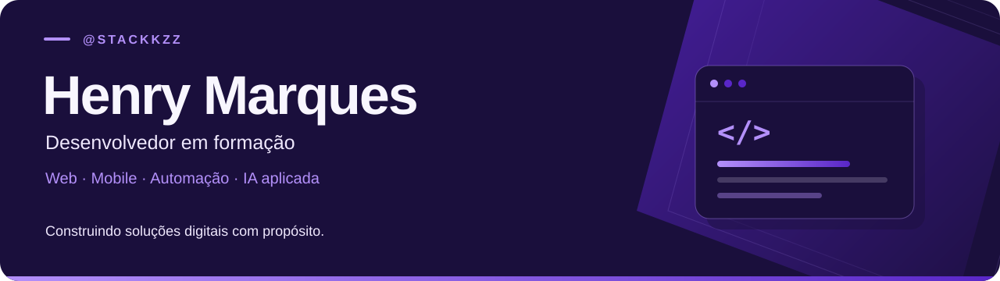
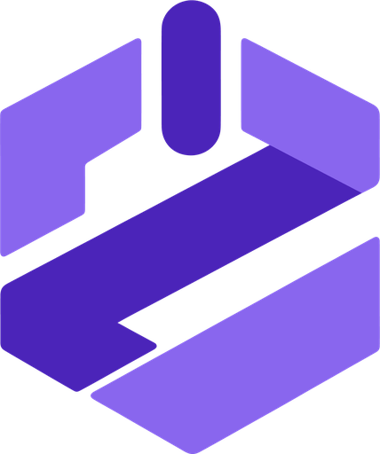

  

  <a href="#sobre-mim">Sobre mim</a> ·
  <a href="#tecnologias">Tecnologias</a> ·
  <a href="#projeto-em-destaque">Projeto em destaque</a> ·
  <a href="#projetos-publicados">Projetos publicados</a> ·
  <a href="https://github.com/stackkzz?tab=repositories">Repositórios</a>

## Sobre mim

Sou **Henry Marques**, desenvolvedor em formação. Construo minha experiência com projetos web e mobile, explorando automação e inteligência artificial aplicada a produtos digitais.

Tenho interesse em soluções para pequenos negócios. Nos meus projetos, busco unir **organização do código, interfaces claras e funcionalidades que resolvam problemas reais**.

Atualmente, desenvolvo o **Zaion**, uma plataforma SaaS de marketing com IA: uma forma de transformar as informações de uma marca em conteúdo para redes sociais.

## Tecnologias

Ferramentas presentes nos meus estudos e projetos:

  
  
  
  

  
  
  

## Projeto em destaque

  <picture>
    <source media="(prefers-color-scheme: dark)" srcset="./projeto-logo-dark.png" />
    
  </picture>

### Zaion · plataforma SaaS de marketing com IA

**Em desenvolvimento · Next.js 16 + Supabase**

> Sua equipe de marketing em um só estúdio, pensada para pequenos negócios.

O Zaion reúne **estratégia, criação e gestão de conteúdo** em um só lugar. A marca cadastra o seu Brand Kit (logos, cores, fontes e regras) e a IA transforma uma ideia em posts, carrosséis e roteiros de Reels alinhados à identidade dela, prontos para revisão e publicação no Instagram.

- **Criar:** artes, carrosséis, roteiros de Reels e ideias de conteúdo com a identidade da marca.
- **Editor em camadas:** a arte gerada vira camadas editáveis de texto, logo e produto, no estilo Canva.
- **Agenda:** planejamento do mês, aprovação e publicação automática no Instagram.
- **Perfil:** saúde da conta, comparação com concorrentes e fila de comentários.
- **Agente:** um assistente de IA que conhece a marca e ajuda no dia a dia.
- **WhatsApp:** confirmações e avisos da conta pelo WhatsApp (em desenvolvimento).

## Projetos publicados

### Qualilan · novo site de distribuidora

**Proposta para cliente · Next.js 16 + Supabase**

> Catálogo com orçamento pelo WhatsApp para uma distribuidora de redes, fibra óptica e CFTV.

Redesenhei o site de uma distribuidora B2B com cinco unidades em SP e MG: catálogo com mais de 180 produtos, busca, filtro por marca e paginação, lista de orçamento enviada pelo WhatsApp e um painel para a equipe editar produtos e fotos. As animações são só CSS e as páginas são pré-renderizadas, com cache invalidado quando o painel salva um produto.

  
  

---

  <strong>Do aprendizado à construção de produtos.</strong>

  

